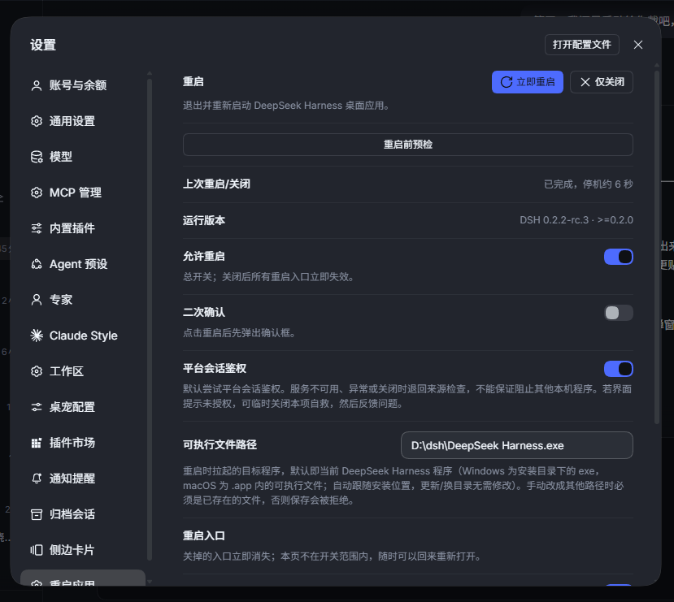
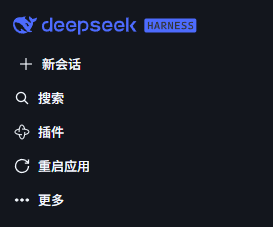
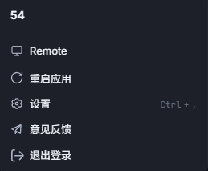

# dsh-restart-now

[中文](README.md) | [English](README.en.md)

[](https://www.npmjs.com/package/dsh-restart-now)
[](https://www.npmjs.com/package/dsh-restart-now)
[](#scope)

One-click restart plugin for the DSH desktop app (Windows 10/11 and macOS 12+).
After installing or updating plugins, or when the app gets stuck, one click closes and relaunches it —
no tray menu, no hunting for the shortcut.



## Install

Same command on Windows (PowerShell) and macOS (Terminal):

```bash
dsh plugin --profile desktop add dsh-restart-now
```

Restart DSH after installing. Run the same command again to upgrade.

## Entry points

One restart action, six entries:

| Entry | Where |
| --- | --- |
| Sidebar panel | Sidebar "Extensions" list → Restart app |
| Sidebar footer | The ⟳ at the very bottom of the sidebar |
| Conversation header | The action area of the conversation title bar |
| Title-bar menu | Next to "Edit" in the Windows title-bar menu; depends on the current desktop shell's menu structure |
| Settings row | Settings → General → Restart app |
| Slash command | `/restart` (supports `--force` / `--wait`) |








Of the six entries, the five UI entries can each be turned off in **Settings → Restart app** (they disappear from the UI immediately);
`/restart` is not affected by these entry switches, but it needs the host command service and is still subject to the master switch and environment/safety gates.
The settings page also shows a running-version self-check, the last restart result (downtime or failure reason),
a read-only **pre-restart preflight**, and a unified in-progress state across entries (spinner + "Restarting…/Closing…",
synchronized disabling to prevent double-clicks).

The sidebar panel and the settings page also offer **Close only**: after confirmation the app exits and
**does not relaunch** — you reopen it manually. When busy, you can force-close or cancel; there is no wait option.
Restarting interrupts running output and tasks; wait mode lasts at most 30 minutes, after which a restart is dispatched
even if tasks are still running. The helper reuses the original launch arguments when they can be parsed safely;
otherwise it starts without arguments. If relaunching fails, reopen the app manually.

### Restart safety (v1.4.0)

- **Process identity verification**: before stopping the main process, the helper checks path, start time and related
  information; on mismatch it aborts and records the reason, reducing the risk of wrong-process operations.
  The check and the termination are not atomic, so races cannot be fully excluded.
- **Visible failures**: exceptions after dispatch (identity mismatch, process not stopping, unconfirmed outcome)
  are surfaced in a dialog instead of failing silently.
- **Read-only preflight**: one click in Settings shows the current environment, target executable, install lock,
  tasks and cooldown state. It is an instant snapshot; it does not guarantee a later restart will be safe, and
  process identity and launch arguments are not verified in preflight.

| Receipt | Meaning |
| --- | --- |
| No record | No readable receipt for a previous operation; nothing inferred |
| Dispatched, unconfirmed | Request recorded, no completion or failure result yet |
| Completed | The new process passed a short liveness check; does not prove all plugins are ready |
| Failed | The helper recorded a failure reason |
| Closed | A "close only" completed; no relaunch |

Listening and HTTP probing are observational only: a 2xx response on a local port does not prove the response
comes from the target app, let alone that the app is ready. A hot reload is not a restart request of this plugin
and does not update the receipt.

## What it does

1. While a plugin install/uninstall is in progress, restarts are blocked. With active tasks you can wait, force, or cancel.
2. The helper stops the main process first, leaving the host time to exit and flush data; on timeout the host may be
   force-stopped and unsaved data may be lost.
3. The helper relaunches the app, reusing the original launch arguments when they can be parsed safely;
   otherwise it starts without arguments.
4. The outcome is written to a receipt; the settings page shows downtime or the failure reason.

Both platforms share the same "helper confirm → main process exit → relaunch" flow with different primitives:
Windows stops the main process with `taskkill /F`, observes listening via PowerShell and shows dialogs via PowerShell;
macOS sends SIGTERM first (escalating to SIGKILL after 10 seconds), observes via `lsof`, and shows dialogs via `osascript`.

Security boundary: action endpoints check loopback origin and same-origin information, and platform session
authentication is attempted by default. When the platform auth service is unavailable, throws, or is turned off,
the fence check alone applies — other local programs are not guaranteed to be blocked.

## Configuration

Switches in the Settings → Restart app section save automatically; the executable path is validated and saved on blur.
Configuration is written to the current profile's `restart-now.config.json`, and can also be set in the `config` block
of the profile's `cordis.patch.yml` entry; the file takes precedence over the patch. Default locations:

- Windows: `%USERPROFILE%\.dsh\profiles\desktop\restart-now.config.json`
- macOS: `~/.dsh/profiles/desktop/restart-now.config.json`

| Key | Default | Description |
| --- | --- | --- |
| `allowRestart` | `true` | Master switch; `false` makes the action endpoint return 403 disabled |
| `confirm` | `true` | Ask for confirmation before restarting |
| `entryPanel` | `true` | Sidebar panel entry |
| `entryFooter` | `true` | Sidebar footer button (replaces the deprecated `hideSidebarButton`) |
| `entryHeader` | `true` | Conversation header button |
| `entrySettingsRow` | `true` | Settings → General row |
| `entryTitlebar` | `true` | Windows title-bar menu "Restart" item |
| `platformAuth` | `true` | Attempt platform session auth by default; falls back to the fence check when unavailable or off. Set `false` to recover if the UI itself reports unauthorized |
| `exePath` | `''` | Absolute path to the app executable; blank = auto-detect from the running install (Windows `DeepSeek Harness.exe`; macOS the binary inside the `.app`) |

## Scope

- **OS**: Windows 10/11 and macOS 12+ (Intel / Apple Silicon); on other systems the plugin mounts no entries.
- **DSH Desktop**: declares `>=0.2.0-0`; this is a declared range, not a guarantee that every future version is verified.
  The restart chain has been verified on Windows; the changes in this release have not been fully verified on real
  macOS hardware. The settings page shows the actual version and warns when it is outside the declared range.
  Does not apply to the Web profile / `dsh web`.
  **macOS support needs contributors with real hardware** — the maintainer has no macOS machine. See
  [CONTRIBUTING](CONTRIBUTING.en.md#macos) if you can help.
- No system Node required: the helper uses the app's bundled runtime (on macOS that is the app binary itself
  with `ELECTRON_RUN_AS_NODE=1`).

## Development

```bash
npm test            # node:test, runs on Windows / macOS, no process side effects
npm pack --dry-run  # verify tarball contents (CI runs on Windows / macOS)
```

Architecture and implementation details (gate chain, restart mechanism, client slots, errata history)
are in the `docs/` directory (in Chinese).
