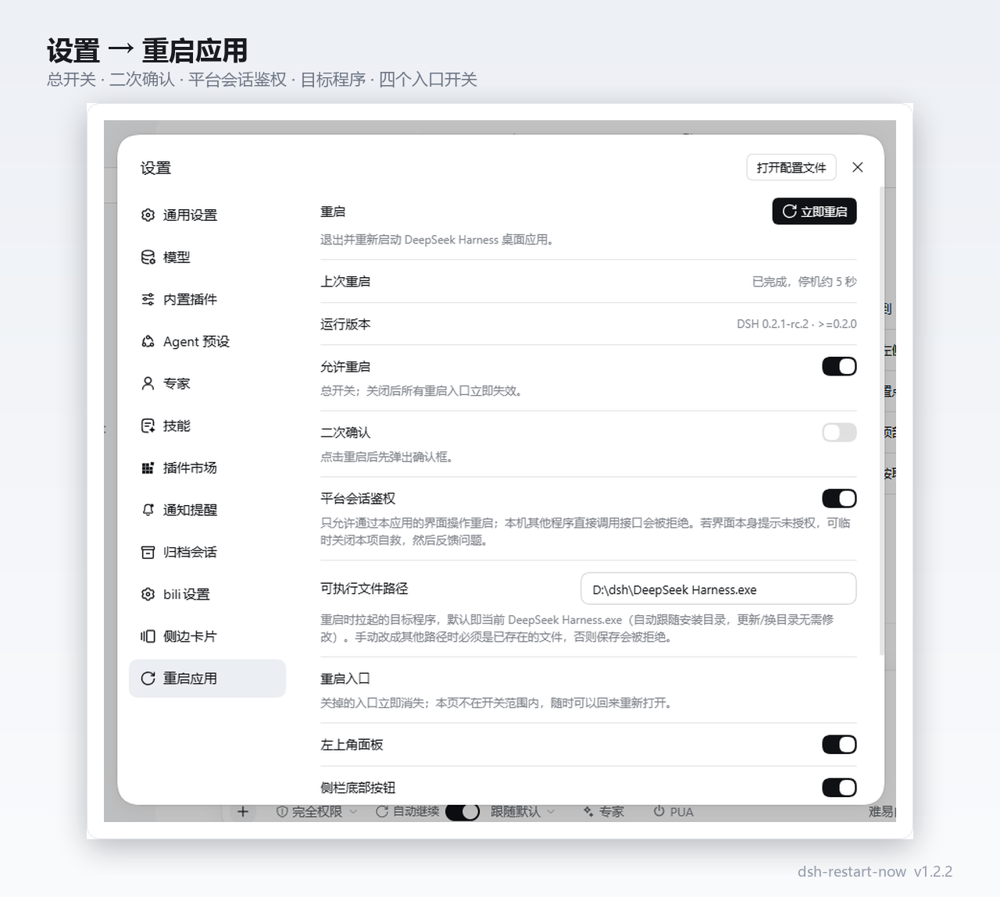
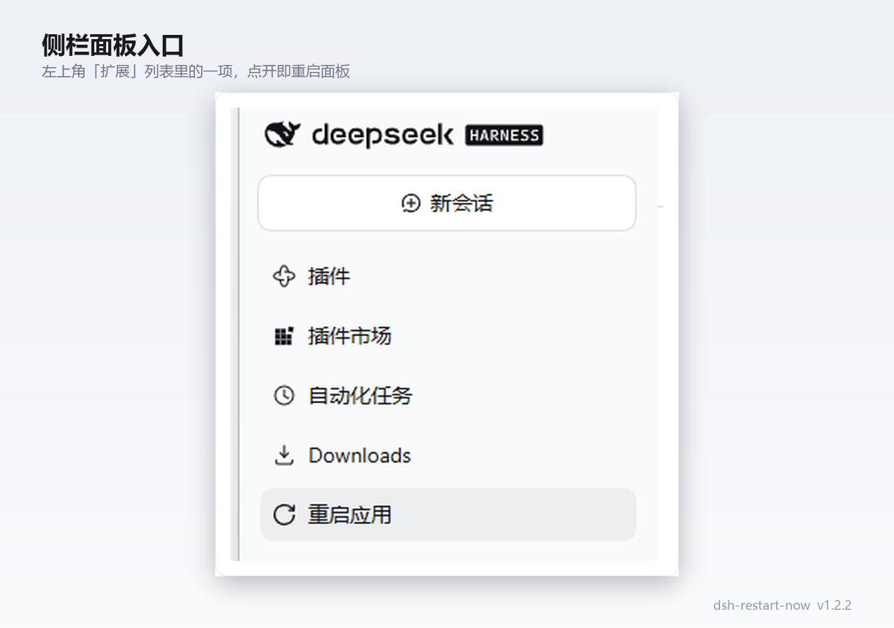
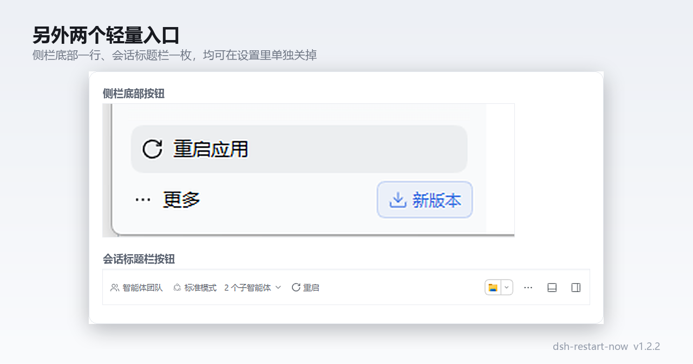

# dsh-restart-now

[](https://www.npmjs.com/package/dsh-restart-now)
[](https://www.npmjs.com/package/dsh-restart-now)
[](#适用范围)

DSH 桌面版一键重启插件（Windows 10/11 与 macOS 12+）。装/更插件、卡住、需要重开时，
点一下就完成「关闭 → 自动拉起」，不用自己关窗口再找快捷方式。



## 安装

Windows（PowerShell）与 macOS（终端）同一条命令：

```bash
dsh plugin --profile desktop add dsh-restart-now
```

安装后重启 DSH 生效。升级时再次运行该命令。

## 入口

同一个重启动作，六个入口：

| 入口 | 位置 |
| --- | --- |
| 侧栏面板 | 侧边栏「扩展」列表 → 重启应用 |
| 侧栏底部按钮 | 侧边栏最下方的 ⟳ |
| 会话标题栏按钮 | 对话标题栏的操作区 |
| 窗口菜单栏 | Windows 桌面版「应用」「编辑」旁的「重启」；依赖当前桌面壳的菜单结构 |
| 设置行 | 设置 → 通用 → 重启应用 |
| 斜杠命令 | `/restart`（支持 `--force` / `--wait`） |





五个界面入口都能在 **设置 → 重启应用** 里单独关掉（关掉即从界面撤除）；
斜杠命令始终可用。设置页同时显示运行版本自检和上次重启结果（成功停机时长或失败原因）。

侧栏面板和插件设置页在助手支持时还提供「仅关闭」：确认后退出应用，**不会自动重启**，需手动打开；忙碌时可选择仍然关闭或取消，不提供等待后重启。重启会中断正在进行的输出和任务；选择等待则在任务结束后重启。助手尽量复用启动参数，无法安全获取时不带参数启动；拉起失败需手动打开。

| 回执情况 | 含义 |
| --- | --- |
| 无记录 | 没有可读取的上次操作回执，不推断是否发生过重启 |
| 已发起，未确认 | 已记录请求，尚无助手完成或失败结果 |
| 已完成 | 新进程通过短时存活检查，不代表所有插件已就绪 |
| 失败 | 助手记录了失败原因 |
| 已关闭 | 「仅关闭」完成，不会自动拉起 |

服务监听与 HTTP 探测仅供观察：本机端口有 2xx 响应也不能证明响应来自目标应用，更不能证明应用已就绪。热重载不是本插件的一次重启请求，回执不会因此更新。

## 它做了什么

1. 点击后如有**正在运行的任务**或**插件正在安装**，会先拦住，让你选：等任务结束再重启 / 仍然重启 / 取消。
2. 确认后**只结束主进程**——宿主自己优雅退出、会话日志正常落盘，不是杀进程树。
3. 独立助手等旧实例完全退出后，把应用重新拉起来（复用你原来的启动参数）：Windows 是 `DeepSeek Harness.exe`，macOS 是应用包内的可执行文件。
4. 结果写成回执，设置页可见「上次重启：已完成，停机约 N 秒」或失败原因。

两平台共用同一套「助手确认 → 主进程退出 → 自动拉起」流程，只是系统原语不同：Windows 用 `taskkill /F` 结束主进程、PowerShell 观测监听/弹窗；
macOS 先发 SIGTERM 请主进程体面退出（10 秒未退再 SIGKILL 升级）、`lsof` 观测监听、`osascript` 弹窗。

安全边界：动作请求仅限本机回环同源，本机其它程序直接调接口会被拒绝（可关）。

## 配置

设置页「重启应用」区块可直接编辑保存（写入 profile 的 `restart-now.config.json`）；
也可在 profile 的 `cordis.patch.yml` 条目 `config` 块中设置。默认位置：

- Windows：`%USERPROFILE%\.dsh\profiles\desktop\restart-now.config.json`
- macOS：`~/.dsh/profiles/desktop/restart-now.config.json`

| 键 | 默认 | 说明 |
| --- | --- | --- |
| `allowRestart` | `true` | 总开关，false 时动作口返回 403 disabled |
| `confirm` | `true` | 点击后二次确认 |
| `entryPanel` | `true` | 侧栏面板入口开关 |
| `entryFooter` | `true` | 侧栏底部按钮开关（取代旧版 `hideSidebarButton`） |
| `entryHeader` | `true` | 会话标题栏按钮开关 |
| `entrySettingsRow` | `true` | 设置 → 通用行的开关 |
| `platformAuth` | `true` | 仅允许本应用界面操作重启，本机其它程序调接口被拒；界面自身失效时可置 `false` 自救 |
| `exePath` | `''` | 应用可执行文件绝对路径；留空时自动从当前安装位置推导（Windows `DeepSeek Harness.exe`；macOS 应用包内主二进制） |

## 适用范围

- **操作系统**：Windows 10/11 与 macOS 12+（Intel / Apple Silicon）；其它系统上插件不挂载任何入口。
- **DSH Desktop**：0.2.0 及以上（验证于 0.2.1-rc.5）。设置页显示实际版本，超出范围红字提示。
  Web profile / `dsh web` 下不生效。
- 无需系统 Node：助手用应用自带运行时（macOS 上就是应用自身二进制 + `ELECTRON_RUN_AS_NODE=1`）。

## 开发

```bash
npm test            # node:test，Windows / macOS 均可跑，零进程副作用
npm pack --dry-run  # 校验 tarball 内容（CI 在 Windows / macOS 上都会跑）
```

架构与实现细节（门禁链、重启机制、客户端槽位、勘误史）见仓库 `docs/` 下的设计文档。
